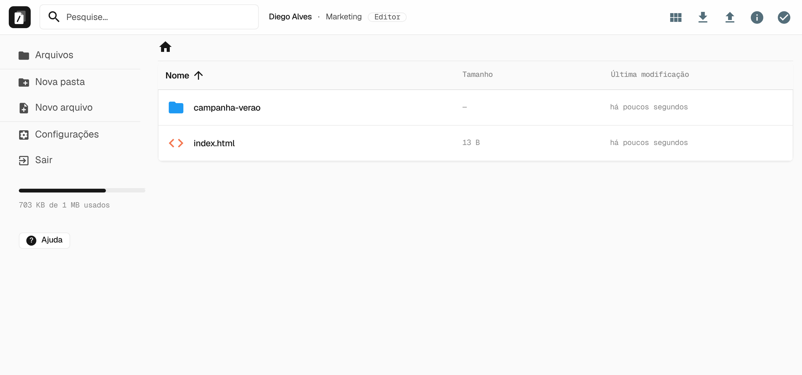
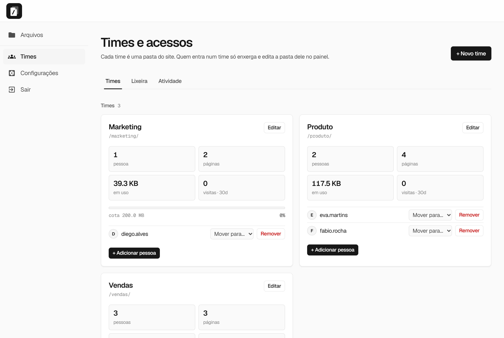
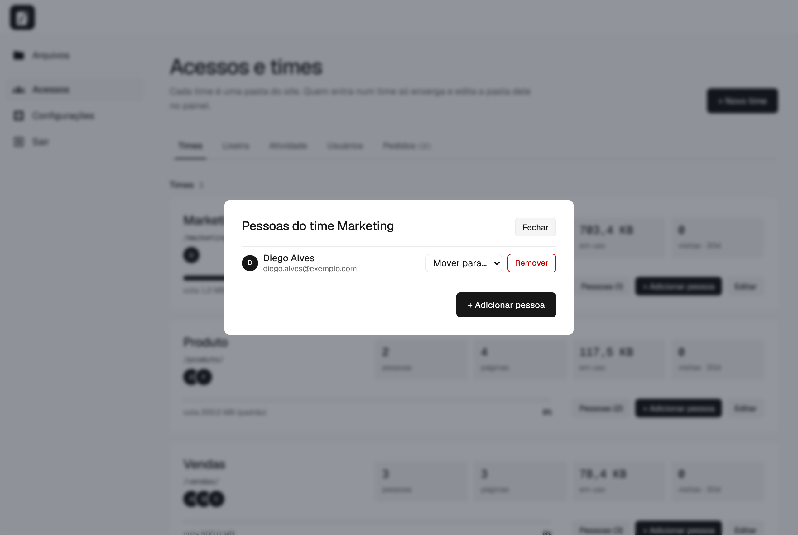
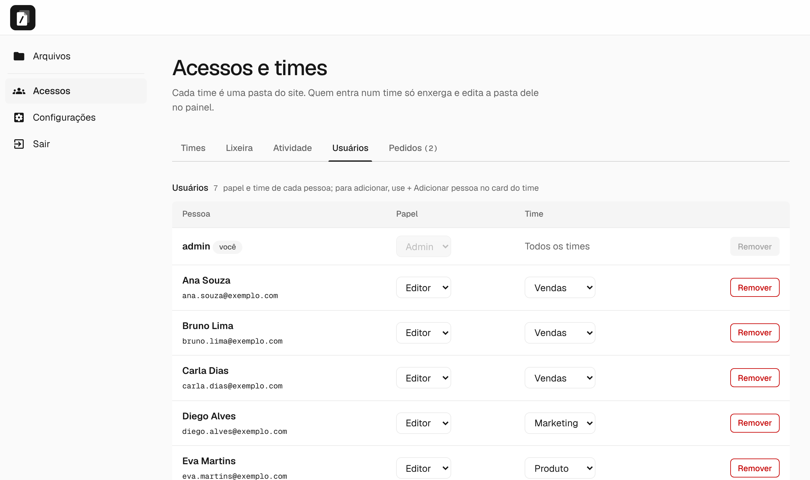
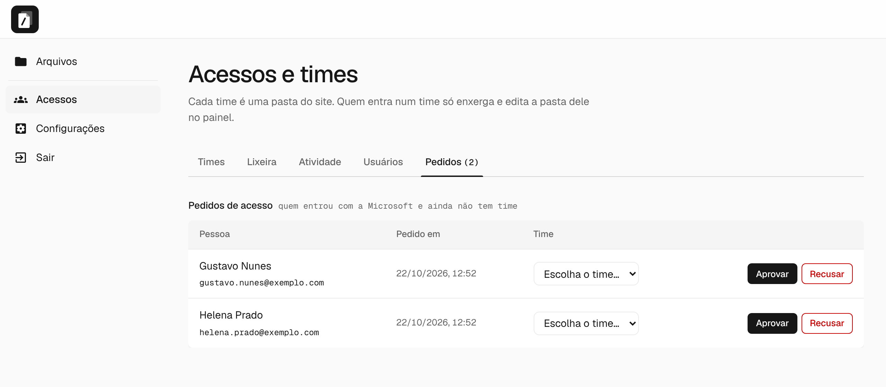
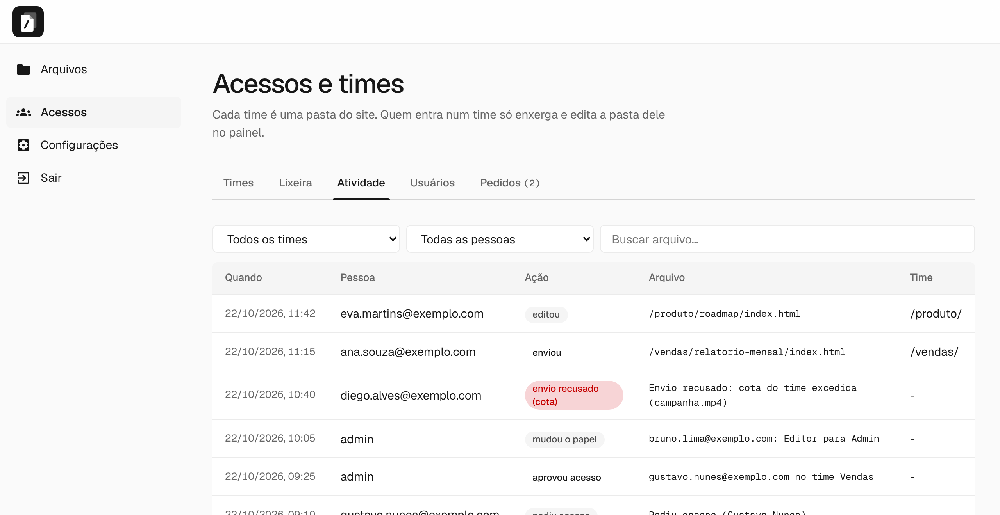
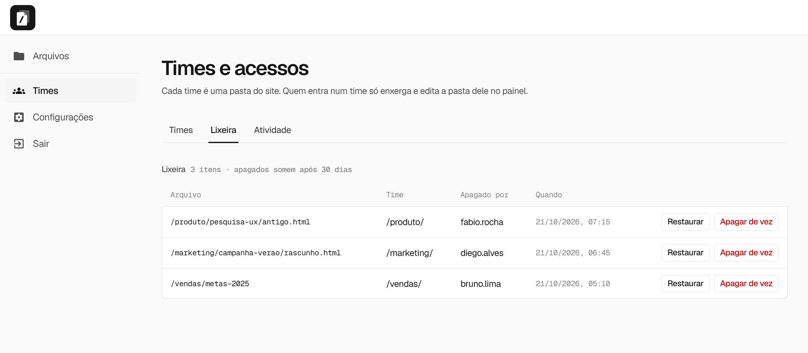
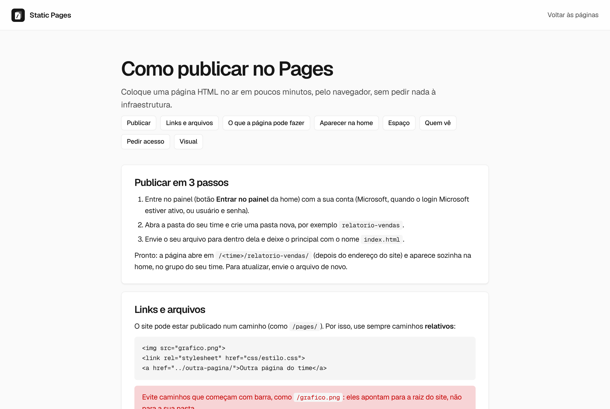
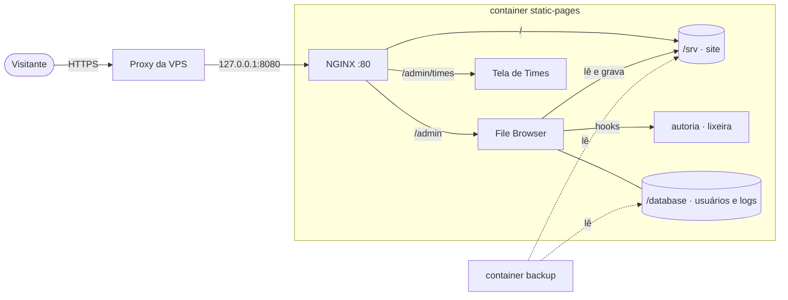

<a id="topo"></a>

<p align="center">
  
</p>

<p align="center">
  <a href="https://github.com/JTech-Dados/static-pages/actions/workflows/ci.yml"></a>
  <a href="LICENSE"></a>
  
  
  
  
</p>

<p align="center">
  <b>Deploy de dashboard HTML em segundos: arraste o arquivo no navegador e ganhe uma URL. Um container, pronto para VPS.</b><br>
  NGINX serve o site em <code>/</code> · File Browser edita em <code>/admin</code> · times, lixeira, auditoria e visitas incluídos.
</p>

<p align="center">
  <a href="#-início-rápido">Início rápido</a> ·
  <a href="#-recursos">Recursos</a> ·
  <a href="#️-telas">Telas</a> ·
  <a href="#-arquitetura">Arquitetura</a> ·
  <a href="#-segurança">Segurança</a> ·
  <a href="docs/">Docs</a>
</p>

---

<details>
<summary><b>Sumário</b></summary>

- [Por quê](#-por-quê)
- [Recursos](#-recursos)
- [Início rápido](#-início-rápido)
- [Telas](#️-telas)
- [Arquitetura](#-arquitetura)
- [Segurança](#-segurança)
- [Configuração](#️-configuração)
- [Deploy na VPS](#-deploy-na-vps)
- [Operação](#️-operação)
- [Conteúdo: home, times e meta.json](#-conteúdo-home-times-e-metajson)
- [Testes e CI](#-testes-e-ci)
- [FAQ](#-faq)
- [Roadmap](#️-roadmap)
- [Contribuindo](#-contribuindo)
- [Licença](#-licença)

</details>

## 💡 Por quê

Dashboard exportado, relatório, protótipo, landing de campanha: muita coisa só precisa de **um lugar para jogar um `.html` e ter uma URL**. Na prática, cada atualização vira um pedido de SSH, `scp` ou pipeline.

O **static-pages** é esse lugar. Quem publica usa o navegador, quem consome recebe um link, e o admin controla quem edita o quê, vê quem mudou o quê e recupera o que foi apagado.

## ✨ Recursos

| | Recurso | Detalhe |
|---|---|---|
| 🌐 | **Site estático** | qualquer pasta vira página (`/relatorio/` → `relatorio/index.html`); `/pagina` serve `pagina.html` |
| 🗂️ | **Painel de arquivos** | upload, edição de HTML, renomear e mover em `/admin` (File Browser, em pt-br, com tema próprio) |
| 🧭 | **Home automática** | cards montados a partir das pastas (até 3 níveis), divididos **por time**, com filtro e contador de visitas |
| 👥 | **Acessos e times** | cada time é uma pasta; membros só enxergam e editam a pasta do seu time; aba Usuários muda papel e time |
| 🪪 | **Login Microsoft (Entra ID)** | opcional: membros entram com a conta Microsoft; quem não tem acesso pede e o admin aprova |
| 📦 | **Cota por time** | espaço do time na barra do menu; upload acima da cota é recusado (413, mensagem em português) |
| 🔒 | **Páginas restritas** | opcional: o time (ou uma página só) restringe o acesso a e-mails autorizados (login Microsoft); falha fechado |
| 🔑 | **Tokens de API** | token pessoal para automações publicarem HTML sem abrir o painel |
| 🗑️ | **Lixeira** | nada apagado some de vez: admin e editores restauram em 1 clique, por item, por 30 dias |
| 🔗 | **"ver site ↗"** | na lista de arquivos do painel, abre a página publicada da pasta |
| 📖 | **Guia "Como publicar"** | página `/_ajuda/` para quem publica (links relativos, sandbox, cota, visibilidade) |
| ✍️ | **Autoria** | colunas "Time" e "Alterado por" na listagem do painel |
| 📜 | **Atividade** | histórico de envios, edições, exclusões e de acessos (logins, pedidos, papéis, cota), com filtros (só admin) |
| 📈 | **Visitas** | acessos por página e por time nos últimos 30 dias |
| 💾 | **Backup diário** | `tar.gz` dos dados, mantém os últimos 7 |
| 🔒 | **Segurança** | site isolado do painel (CSP sandbox), rate limit no login, dotfiles bloqueados, cadastro público desligado |
| ✅ | **Testes E2E + CI** | 50 testes E2E (pytest + Playwright) e 29 unitários do login Microsoft a cada push |

## 🚀 Início rápido

```bash
git clone https://github.com/JTech-Dados/static-pages.git
cd static-pages
cp .env.example .env              # defina FB_ADMIN_PASSWORD (12+ caracteres)
docker compose up -d --build
```

| | Endereço |
|---|---|
| Site | <http://localhost:8080/> |
| Painel | <http://localhost:8080/admin/> |
| Times | <http://localhost:8080/admin/times> |

> Sem `FB_ADMIN_PASSWORD`, uma senha aleatória é gerada e exibida **uma única vez** no log: `docker compose logs app | grep senha`

**No Windows:** dois cliques em `subir.bat` (ou `subir.bat 9000` para outra porta).

<p align="right"><a href="#topo">↑ voltar ao topo</a></p>

## 🖼️ Telas

<table>
  <tr>
    <td width="50%"><b>Home</b><br></td>
    <td><b>Painel</b><br></td>
  </tr>
  <tr>
    <td width="50%"><b>Login: Microsoft ou usuário e senha</b><br></td>
    <td><b>Visão de um membro: time, papel e espaço do time</b><br></td>
  </tr>
  <tr>
    <td width="50%"><b>Acessos e times: pessoas, páginas, espaço, cota e visitas</b><br></td>
    <td><b>Pessoas do time</b><br></td>
  </tr>
  <tr>
    <td width="50%"><b>Usuários: papel e time de cada pessoa</b><br></td>
    <td><b>Pedidos de acesso: aprovar e escolher o time</b><br></td>
  </tr>
  <tr>
    <td width="50%"><b>Atividade: arquivos e acessos (login, pedido, papel, cota)</b><br></td>
    <td><b>Lixeira: restaurar ou apagar de vez</b><br></td>
  </tr>
  <tr>
    <td width="50%"><b>Guia "Como publicar"</b><br></td>
    <td><b>404</b><br></td>
  </tr>
</table>

<sub>Imagens com dados fictícios, geradas por <code>divulgacao/screenshots.py</code>, <code>screenshots_acessos.py</code> e <code>screenshots_painel.py</code>.</sub>

## 🧱 Arquitetura



| Peça | Papel |
|---|---|
| **NGINX** | serve o site, faz proxy do painel, limita login, bloqueia internos, registra visitas |
| **File Browser** | interface de arquivos e API; escuta só em `127.0.0.1` |
| **Hooks** | `sp-autoria` (quem alterou) e `sp-lixeira` (cópia antes de apagar) |
| **Tela de Times** | página estática que usa a API do File Browser com o token do admin |
| **Backup** | serviço separado, lê os volumes em modo somente leitura |

Detalhes de rotas, volumes e fluxos: **[docs/ARCHITECTURE.md](docs/ARCHITECTURE.md)**.

## 🔒 Segurança

| Ameaça | Proteção |
|---|---|
| HTML enviado por upload rouba a sessão do admin | CSP `sandbox` no site: páginas rodam em origem opaca e não leem o token do painel |
| Força bruta no login | 5 tentativas/min por IP → HTTP 429 |
| Conta criada por estranhos | cadastro público desligado a cada boot |
| Vazamento de `.env`, `.git`, logs | dotfiles, `/_lixeira/` e `/_backup/` respondem 404 |
| Membro vendo outro time | escopo por usuário no File Browser; tela de Times e auditoria só para admin |
| Path traversal | NGINX normaliza o caminho; testado com `../`, `%2e%2e` e afins |
| Conteúdo de upload injetando HTML na home | nomes e `meta.json` entram só via `textContent` |

> ⚠️ O site é **público** para quem tem a URL: os times controlam **quem edita**. Quem **vê** só é limitado nas páginas de time com [acesso restrito](#-páginas-com-acesso-restrito) (v1). Veja o [Roadmap](#️-roadmap).

Política de reporte: **[SECURITY.md](SECURITY.md)** · Regras inegociáveis: **[docs/RULES.md](docs/RULES.md)**.

## ⚙️ Configuração

Todas as variáveis ficam em [`.env.example`](.env.example).

<details>
<summary><b>Tabela de variáveis</b></summary>

| Variável | Padrão | O que faz |
|---|---|---|
| `FB_ADMIN_USER` | `admin` | usuário criado no 1º boot |
| `FB_ADMIN_PASSWORD` | *(vazio)* | vazia = gera aleatória; definida = sincronizada a cada boot |
| `FB_SYNC_ADMIN_PASSWORD` | `true` | `false` mantém a senha trocada pela interface |
| `SP_BASE` | *(vazio)* | prefixo público atrás de um proxy (ex.: `/pages`): site em `/pages/`, painel em `/pages/admin/` |
| `HOME_FROM_SRV` | `false` | `true` serve home, 404 e favicon do `/srv` (editáveis pelo painel); padrão: vêm da imagem |
| `SITE_NOINDEX` | `false` | `true` manda `X-Robots-Tag: noindex` (conteúdo interno, fora de buscadores) |
| `ENTRA_TENANT_ID` / `ENTRA_CLIENT_ID` | *(vazios)* | login Microsoft; vazios = desligado. App "SPA" (sem secret) no Entra ID |
| `ENTRA_REDIRECT_URI` | *(vazio)* | vazio = `https://<domínio>[/prefixo]/admin/entra/retorno` (cadastre no app Entra) |
| `TEAM_QUOTA_MB` | `200` | cota padrão por time (MB); upload acima dela é recusado |
| `FB_BRANDING_NAME` | `Static Pages` | nome exibido no painel |
| `FB_LOCALE` | `pt-br` | idioma de novos usuários |
| `SITE_SANDBOX` | `true` | isolamento do site (ver Segurança) |
| `HTTP_PORT` / `HTTP_BIND` | `8080` / `0.0.0.0` | porta publicada; use `127.0.0.1` atrás de proxy |
| `LIXEIRA_DIAS` | `30` | dias até apagar de vez o que está na lixeira |
| `VISITAS_DIAS` | `30` | janela do contador de visitas |
| `BACKUP_HORA` / `BACKUP_MANTER` | `3` / `7` | horário (Brasília) e quantidade de backups |
| `APK_HTTP` | `false` | `true` só em rede com inspeção SSL que quebra o build |

</details>

## 🐳 Variante para Portainer / GitOps

Orquestradores que clonam o repo e não têm o `.env` nem bind mount de arquivo (Portainer, por exemplo) usam o [`docker-compose.portainer.yml`](docker-compose.portainer.yml): variáveis por `environment:` (cadastre-as na stack), backup com imagem própria ([`Dockerfile.backup`](Dockerfile.backup)), rede fixa `static-pages-net` para um proxy na mesma máquina e nenhuma porta no host. Para testar localmente: `docker compose -f docker-compose.portainer.yml -f docker-compose.portainer.local.yml up -d --build`.

## 🪪 Login Microsoft (Entra ID)

Opcional e desligado por padrão. Para ligar:

1. No Entra ID, registre um app do tipo **SPA** (sem secret) e anote `Tenant ID` e `Client ID`.
2. Cadastre o Redirect URI `https://<seu-domínio>[/prefixo]/admin/entra/retorno` (ou o de `ENTRA_REDIRECT_URI`).
3. Defina `ENTRA_TENANT_ID` e `ENTRA_CLIENT_ID` no `.env` e reinicie.

Membros são usuários do File Browser com o **e-mail como nome de usuário**; quem entra com Microsoft sem cadastro vê "Solicitar acesso" e o admin aprova na aba **Pedidos** (escolhendo o time). O servidor valida o token (assinatura, emissor, audiência, tenant, validade, uso único). O `admin` local continua só com usuário e senha, como contingência. Detalhes em [ARCHITECTURE](docs/ARCHITECTURE.md). Observação: a suíte testa o fluxo com um Entra de teste; valide o login com o seu tenant real ao ligar.

## 🔒 Páginas com acesso restrito

Admin e editores de um time ligam, no painel (**Acesso restrito**), a restrição a e-mails autorizados (login Microsoft), para o time inteiro ou para uma página só (**Onde aplicar**); a página restrita tem lista própria. Quem não está na lista vê uma tela de entrada e não lê o conteúdo; membros do time e admins entram sempre. A v1 protege a **navegação**: o conteúdo restrito precisa ser um HTML autocontido (assets e `fetch` de arquivos separados não carregam). Falha fechado: se o `sp-auth` cair, nada do time restrito é servido. Quem entra com a Microsoft e não está na lista pode **pedir acesso**; admins e editores aprovam na tela Acesso restrito. Detalhes e limites em [ARCHITECTURE](docs/ARCHITECTURE.md) e `specs/2026-10-23-entra-por-site.md`.

## 🔑 Tokens de API (automações)

Quem tem conta de e-mail vê **Tokens de API** no menu do painel: cria um token pessoal (nome e validade de 30, 90 ou 365 dias; admin até 90), copia na hora e usa numa automação para publicar HTML no próprio time, sem abrir o painel. O script troca o token por uma sessão (`POST /admin/entra/api/sessao`) e chama a API do File Browser, com as regras de sempre: time, papel (o Leitor não publica), cota e autoria. Só o hash do token fica em `/database/api-tokens.json`; revogue na mesma tela. O guia `/_ajuda/` tem o passo a passo, o exemplo em `curl` e o `publicar.py`. Spec: `specs/2026-10-22-tokens-de-api.md`.

## 🌍 Deploy na VPS

Com um NGINX já cuidando do HTTPS no host:

```bash
# .env: HTTP_BIND=127.0.0.1, HTTP_PORT=8080, FB_ADMIN_PASSWORD forte
docker compose up -d --build
```

<details>
<summary><b>Bloco <code>server</code> do NGINX da VPS</b></summary>

```nginx
server {
    server_name meusite.com.br;
    # listen 443 ssl + certificados que você já usa

    client_max_body_size 0;          # uploads grandes no /admin
    proxy_request_buffering off;
    proxy_read_timeout 1h;
    proxy_send_timeout 1h;

    location / {
        proxy_pass http://127.0.0.1:8080;
        proxy_http_version 1.1;
        proxy_set_header Host              $host;
        proxy_set_header X-Real-IP         $remote_addr;
        proxy_set_header X-Forwarded-For   $proxy_add_x_forwarded_for;
        proxy_set_header X-Forwarded-Proto $scheme;
        proxy_set_header Upgrade           $http_upgrade;
        proxy_set_header Connection        "upgrade";
    }
}
```

Sem proxy no host? A pasta [`proxy/`](proxy/) tem um Caddy com HTTPS automático (desativado).

</details>

> Antes de atualizar a VPS, confira o ✅ do CI no commit.

## 🛠️ Operação

| Tarefa | Comando |
|---|---|
| Atualizar | `git pull && docker compose up -d --build` |
| Logs | `docker compose logs -f app` |
| Backups feitos | `docker compose logs backup` e pasta `./backups` |
| Histórico completo | `docker compose exec app tail -50 /database/auditoria.log` |
| Parar | `docker compose down` (os volumes ficam) |

<details>
<summary><b>Restaurar um backup</b></summary>

```bash
docker compose stop app
docker run --rm -v static-pages_srv:/data/srv -v static-pages_db:/data/db -v "$PWD/backups":/b alpine \
  sh -c "rm -rf /data/srv/* /data/srv/.[!.]* /data/db/* && tar -xzf /b/static-pages-AAAA-MM-DD_HHMM.tar.gz -C /data"
docker compose start app
```

O banco do File Browser é copiado com o app rodando. Para um backup 100% consistente, rode-o com o app parado.

</details>

## 📝 Conteúdo: home, times e meta.json

- Cada pasta precisa de um `index.html` para virar página (`Index.html` e `INDEX.HTML` também valem).
- Pastas que começam com `_` ou `.` ficam fora do menu, mas continuam acessíveis pela URL.
- Uma pasta-**time** (com `.time.json`) vira uma seção na home. As subpastas dela viram os cards.
- Um time criado pela tela já nasce com uma página inicial que lista as subpastas sozinha.

<details>
<summary><b><code>meta.json</code> opcional para personalizar o card</b></summary>

```json
{
  "titulo": "Relatório de Vendas",
  "descricao": "Resultados do trimestre por região.",
  "tag": "Dashboard",
  "ordem": 1,
  "oculto": false
}
```

</details>

> A home, a 404 e o favicon (`content/index.html`, `404.html`, `favicon.svg`) são servidos **pela imagem**: para mudar, edite `content/` e reimplante. Quer editá-los pelo painel? Use `HOME_FROM_SRV=true`. O resto de `content/` é semente do `/srv`.

## ✅ Testes e CI

```bash
pip install -r tests/requirements.txt && python -m playwright install chromium
python -m pytest tests -v                        # usa FB_ADMIN_PASSWORD do .env
BROWSER_CHANNEL=msedge python -m pytest tests    # usa o Edge instalado
```

Os testes cobrem login Microsoft (com um Entra de teste), cota, rotas, headers, bloqueios, path traversal, permissões da auditoria, times, membros, colunas, lixeira, atividade, home por time e visitas. Tudo que eles criam usa o prefixo `zz-` e é removido no final, então dá para rodar no servidor real. O [CI](.github/workflows/ci.yml) builda, sobe e roda a suíte a cada push.

## ❓ FAQ

<details>
<summary><b>Quem tem o link consegue ver qualquer página?</b></summary>

Sim, salvo nas páginas de um time com [acesso restrito](#-páginas-com-acesso-restrito): aí só entra quem está na lista de e-mails (login Microsoft). Fora isso, os times controlam **quem edita**.
</details>

<details>
<summary><b>Por que minha página não consegue usar <code>localStorage</code> ou cookies?</b></summary>

Por causa do CSP `sandbox`, que impede uma página enviada por upload de roubar a sessão do admin. Se o site precisar disso, sirva o painel num subdomínio próprio e desligue `SITE_SANDBOX` (ver [MEMORY](docs/MEMORY.md)).
</details>

<details>
<summary><b>A cota bloqueia uploads?</b></summary>

Sim. Membros de um time não conseguem enviar acima da cota (o painel recusa com um aviso em português); admins não têm limite. A barra do menu mostra o espaço usado do time.
</details>

<details>
<summary><b>Apaguei sem querer. E agora?</b></summary>

Vá em **Acessos → Lixeira → Restaurar**. Depois de 30 dias o item some de vez, mas ainda existe nos backups diários.
</details>

<details>
<summary><b>Editei <code>content/index.html</code> e a home não mudou.</b></summary>

A home vem da imagem: reimplante (`docker compose up -d --build`). Se preferir editar pelo painel, defina `HOME_FROM_SRV=true` e envie o `index.html` para a raiz.
</details>

## 🗺️ Roadmap

Backlog vivo com prioridade e critério de pronto: **[docs/TASKS.md](docs/TASKS.md)**. Destaques:

- [ ] Backup fora da VPS
- [ ] Imagem publicada no GHCR (deploy sem build)
- [ ] Acesso restrito, modo A: assets e `fetch` com cookie (hoje a v1 protege a navegação e exige HTML autocontido)
- [ ] Painel em subdomínio próprio

## 🤝 Contribuindo

Leia o **[CONTRIBUTING.md](CONTRIBUTING.md)**. Em resumo: toda mudança começa por uma **spec** em [`specs/`](specs/_modelo.md), segue as [regras](docs/RULES.md) e só é commitada com os testes verdes.

| Doc | Responde |
|---|---|
| [PRD](docs/PRD.md) | por quê: problema, público, fora do escopo |
| [ARCHITECTURE](docs/ARCHITECTURE.md) | como funciona: peças, rotas, fluxos |
| [RULES](docs/RULES.md) | o que não pode |
| [DESIGN](DESIGN.md) | como deve parecer |
| [MEMORY](docs/MEMORY.md) | decisões e erros, com data e motivo |
| [TASKS](docs/TASKS.md) | o que falta |

Com o Claude Code: `/spec` para planejar, o agente `tech-lead` para o desenho técnico e `/finalizar-commit` para conferir e commitar (ver [CLAUDE.md](CLAUDE.md)).

## 📄 Licença

[MIT](LICENSE). Use, modifique e distribua à vontade.

<p align="right"><a href="#topo">↑ voltar ao topo</a></p>
