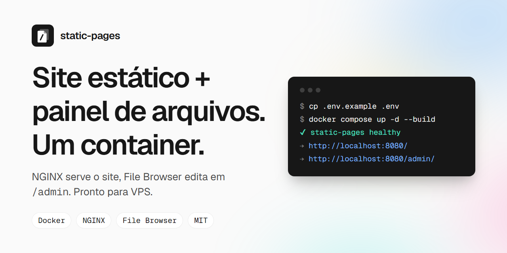
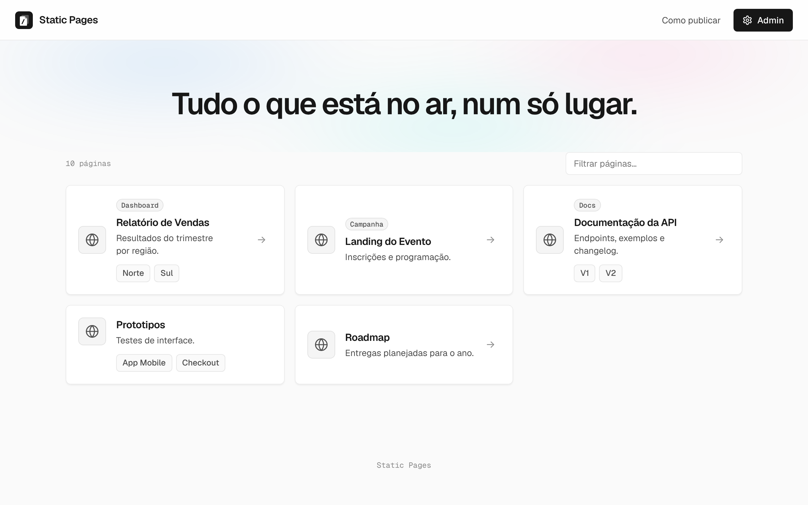
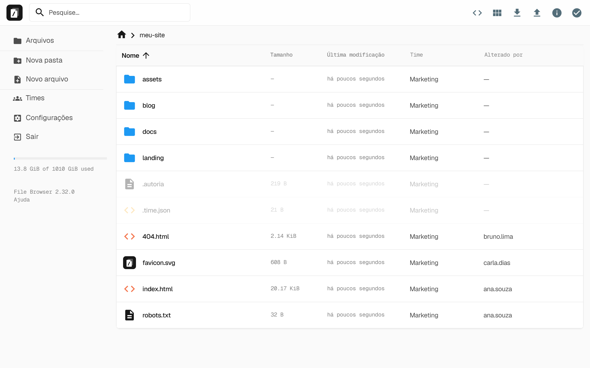
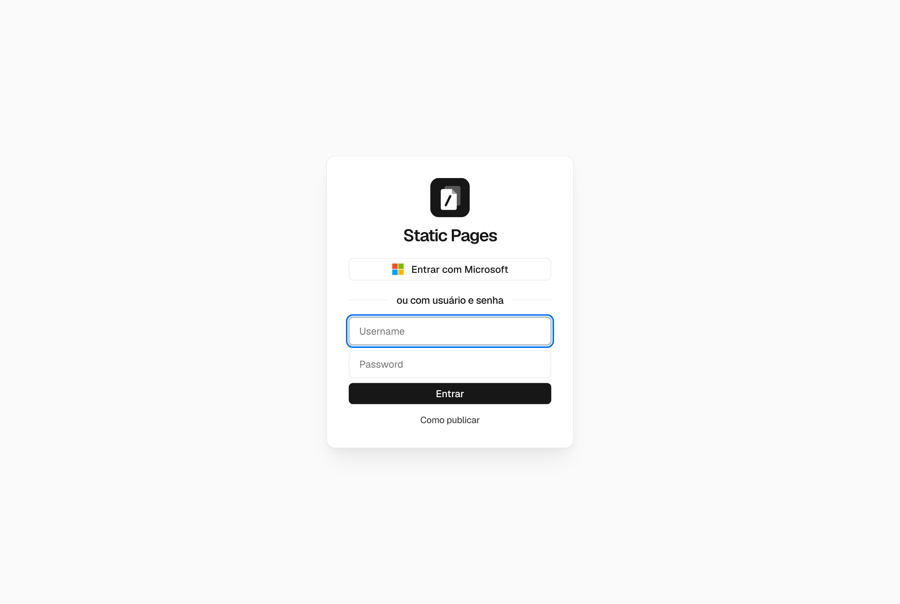
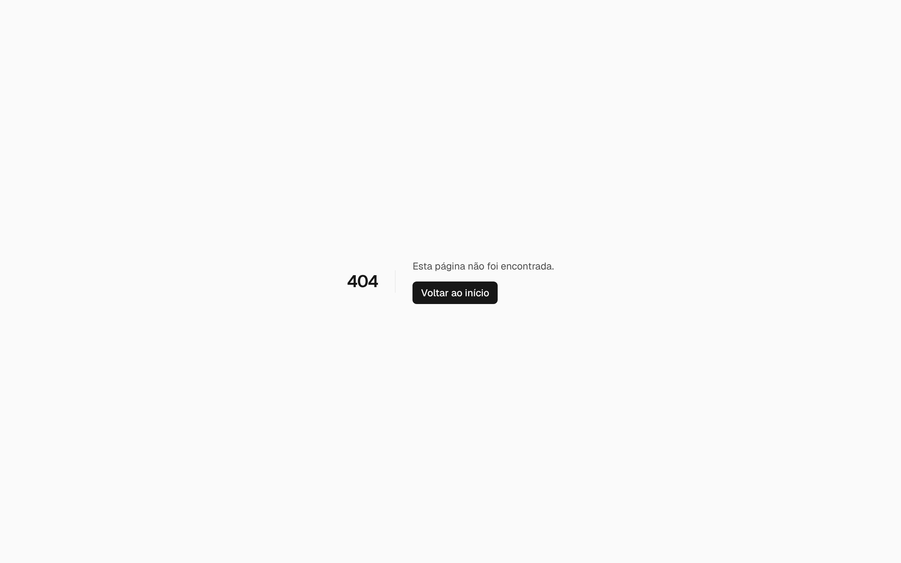
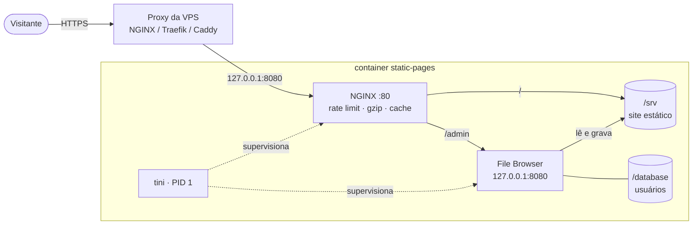

<p align="center">
  
</p>

<p align="center">
  <a href="LICENSE"></a>
  
  
  
  
</p>

<p align="center">
  <b>Publique e edite um site estático pelo navegador.</b><br>
  NGINX serve o site em <code>/</code> · File Browser edita os arquivos em <code>/admin</code> · tudo num container só.
</p>

---

## Por quê

Página interna, protótipo HTML, relatório exportado, landing de campanha: muita coisa só precisa de **um lugar para jogar um `.html` e ter uma URL**. Mas cada atualização acaba exigindo SSH, `scp` ou um pipeline.

O **static-pages** resolve isso com um container que:

- 🌐 **serve** qualquer pasta como site (`/relatorio/` → `relatorio/index.html`);
- 🗂️ **edita** os arquivos pelo navegador (upload, renomear, editar HTML) em `/admin`;
- 🔒 **isola** o site do painel, para que um upload malicioso não roube a sessão do admin;
- 🚀 **sobe** com `docker compose up -d` e fica atrás do proxy que você já tem.

## Como fica

| Site (`/`) | Painel (`/admin`) |
|---|---|
|  |  |
| **Login** | **404** |
|  |  |

## Início rápido

```bash
git clone https://github.com/JTech-Dados/static-pages.git
cd static-pages
cp .env.example .env              # defina FB_ADMIN_PASSWORD (12+ caracteres)
docker compose up -d --build
```

- Site: <http://localhost:8080/>
- Painel: <http://localhost:8080/admin/>

> Sem `FB_ADMIN_PASSWORD`, uma senha aleatória é gerada e exibida **uma única vez** no log:
> `docker compose logs app | grep senha`

**No Windows:** dê dois cliques em `subir.bat` (ou rode `subir.bat 9000` para usar outra porta).

## Arquitetura



| Peça | Papel |
|---|---|
| **NGINX** | Serve `/srv`, faz proxy de `/admin`, limita tentativas de login, bloqueia dotfiles, comprime e cacheia |
| **File Browser** | Interface de arquivos. Escuta **só** em `127.0.0.1` e roda como usuário `nginx`, para que os uploads saiam legíveis pelo servidor |
| **tini** | PID 1: repassa sinais e recolhe zumbis. Se um processo cai, o container sai com o código de erro e o Docker reinicia |
| **entrypoint.sh** | Popula `/srv`, corrige donos de arquivos, cria o admin, aplica branding e idioma |

## Segurança

| Proteção | Como |
|---|---|
| **Site isolado do painel** | CSP `sandbox` em `/`: páginas enviadas rodam numa origem opaca e não leem o token do admin (`SITE_SANDBOX`) |
| **Força bruta** | `/admin/api/login` limitado a 5 tentativas/min por IP → HTTP 429 |
| **Senha** | Aleatória no 1º boot ou vinda do `.env`. Nunca fica fixa na imagem |
| **Dotfiles** | `.env`, `.git` e afins enviados por engano respondem 404 |
| **Headers** | `nosniff`, `Referrer-Policy`, `X-Frame-Options`, `Permissions-Policy`, `server_tokens off` |
| **Superfície** | Só a porta 80 do container é publicada; o File Browser não é acessível de fora |
| **Versões** | `nginx` e `filebrowser` fixados por tag, nada de `latest` |

> ⚠️ `SITE_SANDBOX=true` também tira `localStorage` e cookies do **site**. Se as suas páginas precisarem deles, use `false` **e** sirva o admin num subdomínio separado.

## Configuração

Todas as chaves ficam em [`.env.example`](.env.example).

| Variável | Padrão | O que faz |
|---|---|---|
| `FB_ADMIN_USER` | `admin` | Usuário criado no 1º boot |
| `FB_ADMIN_PASSWORD` | *(vazio)* | Vazia = gera aleatória. Definida = sincronizada a cada boot |
| `FB_SYNC_ADMIN_PASSWORD` | `true` | `false` mantém a senha trocada pela interface |
| `FB_BASEURL` | `/admin` | Caminho do painel (ajuste também `conf/nginx/default.conf`) |
| `FB_BRANDING_NAME` | `Static Pages` | Nome exibido no painel |
| `FB_LOCALE` | `pt-br` | Idioma de novos usuários |
| `SITE_SANDBOX` | `true` | Isolamento do site (ver Segurança) |
| `HTTP_PORT` | `8080` | Porta publicada no host |
| `HTTP_BIND` | `0.0.0.0` | Use `127.0.0.1` atrás de um proxy na mesma máquina |
| `APK_HTTP` | `false` | `true` só em rede com inspeção SSL que quebra o build |

## Deploy na VPS

Com um NGINX já cuidando do HTTPS no host:

```bash
# .env: HTTP_BIND=127.0.0.1, HTTP_PORT=8080, FB_ADMIN_PASSWORD forte
docker compose up -d --build
```

```nginx
server {
    server_name meusite.com.br;
    # listen 443 ssl + certificados que você já usa

    client_max_body_size 0;          # uploads grandes no /admin
    proxy_request_buffering off;
    proxy_read_timeout 1h;
    proxy_send_timeout 1h;

    location / {
        proxy_pass http://127.0.0.1:8080;
        proxy_http_version 1.1;
        proxy_set_header Host              $host;
        proxy_set_header X-Real-IP         $remote_addr;
        proxy_set_header X-Forwarded-For   $proxy_add_x_forwarded_for;
        proxy_set_header X-Forwarded-Proto $scheme;
        proxy_set_header Upgrade           $http_upgrade;
        proxy_set_header Connection        "upgrade";
    }
}
```

Sem proxy no host? A pasta [`proxy/`](proxy/) tem um Caddy com HTTPS automático, hoje desativado.

### Operação

| Tarefa | Comando |
|---|---|
| Atualizar | `git pull && docker compose up -d --build` |
| Logs | `docker compose logs -f` |
| Backup | `docker run --rm -v static-pages_srv:/s -v static-pages_db:/d -v "$PWD":/b alpine tar czf /b/backup.tgz /s /d` |
| Parar | `docker compose down` (os volumes são preservados) |

## Menu automático da home

A home (`content/index.html`) monta os cards sozinha. Criou uma pasta no `/admin`, ela aparece no próximo F5, sem editar HTML.

- **Fonte:** `/_pastas/<caminho>/`, a listagem JSON do NGINX (`autoindex_format json`).
- **Subpastas:** até 3 níveis. Elas viram links dentro do card da pasta mãe.
- **Regras:** só entra pasta com `index.html`. Uma pasta sem index, mas com sub-páginas, vira grupo. Pastas que começam com `_` ou `.` ficam fora do menu (continuam acessíveis pela URL).
- **`meta.json` (opcional)** dentro da pasta personaliza o card:

```json
{
  "titulo": "Relatório de Vendas",
  "descricao": "Resultados do trimestre por região.",
  "tag": "Dashboard",
  "ordem": 1,
  "oculto": false
}
```

> O site roda sob CSP `sandbox` (origem opaca), então `/_pastas/`, `meta.json` e os arquivos do site respondem com `Access-Control-Allow-Origin: *`. Isso nunca vale para o `/admin`. A listagem só expõe nomes que já são públicos pela URL.

## Times (gestão de acesso no painel)

No `/admin`, o menu lateral ganha o item **Times** (só para admins), que abre `/admin/times`:

| Ação | O que acontece |
|---|---|
| **Novo time** | Cria a pasta `/srv/<time>/` e um `.time.json` com nome e cota |
| **Transformar em time** | Marca uma pasta que já existe como time, sem mexer nos arquivos |
| **Adicionar pessoa** | Cria o usuário com escopo `/<time>` e permissão de editor. A senha é gerada e exibida uma vez |
| **Usuário existente** | Move a pessoa para o time (troca o escopo) |
| **Mover / Remover** | Troca de time ou apaga o usuário. Os arquivos do time ficam |
| **Desfazer time** | Remove só o `.time.json`. As pessoas ficam "sem time" (`/_sem-time`) |

Cada card mostra **pessoas**, **páginas** (pastas com `index.html`), **espaço em uso** e a barra de **cota**. A cota só **alerta** (80% e 100%) e não bloqueia uploads, porque o File Browser não tem esse controle.

**Como funciona:**
- Time = pasta de 1º nível com `.time.json`. Dotfiles respondem 404 no site, então o arquivo não vaza.
- Membro = usuário com aquele escopo. O File Browser restringe o painel à pasta.
- A tela é estática e usa a API do File Browser com o token do admin logado. O item de menu é injetado pelo NGINX (`sub_filter`) com `conf/times/inject.js`.
- O cadastro público de contas é **desligado a cada boot** (`--signup=false`).

> Os times controlam **quem edita**. O site continua público: quem tem a URL vê qualquer página.

## Boas práticas de conteúdo

- Cada pasta precisa de um `index.html` para abrir em `/pasta/`. `Index.html` e `INDEX.HTML` também funcionam.
- `/pagina` serve `pagina.html` automaticamente.
- Páginas novas do `content/` só entram num `/srv` vazio. O conteúdo existente nunca é sobrescrito.

## Estrutura

```
static-pages/
├── Dockerfile                 # imagem: nginx + filebrowser + tini
├── docker-compose.yml         # local e VPS
├── .env.example               # todas as variáveis
├── subir.bat                  # atalho Windows
├── DESIGN.md                  # contrato visual (tokens, tipografia, guardrails)
├── conf/
│   ├── entrypoint.sh          # startup
│   ├── nginx/                 # default.conf + snippets
│   ├── branding/              # CSS, logo e ícones do /admin
│   └── times/                 # tela /admin/times + item de menu
├── content/                   # páginas iniciais (seed de /srv)
├── proxy/                     # Caddy opcional (desativado)
├── docs/img/                  # imagens deste README
└── divulgacao/                # scripts que geram banner, prints e carrossel
```

## Alternativas

Pesquisei projetos que juntam NGINX e File Browser. Os que existem são pequenos experimentos, sem documentação ou endurecimento:

| Projeto | Diferença |
|---|---|
| [`filebrowser/filebrowser`](https://github.com/filebrowser/filebrowser) | Só o gerenciador de arquivos. Não serve as páginas como site |
| Caddy `file_server browse` | Lista e serve arquivos, mas não tem upload nem edição |
| Coolify / Netlify / Vercel | Deploy via Git ou CLI. Ótimos, mas não para "subir um HTML pelo navegador" |
| **static-pages** | Site + edição pelo navegador + isolamento entre os dois, num container |

## Regenerar as imagens

```bash
python divulgacao/banner.py                                      # docs/img/banner.png
FB_USER=admin FB_PASS=... python divulgacao/screenshots.py       # prints (requer playwright)
python divulgacao/build.py                                       # carrossel 1080×1350 + PDF
```

## Licença

[MIT](LICENSE). Use, modifique e distribua à vontade.
